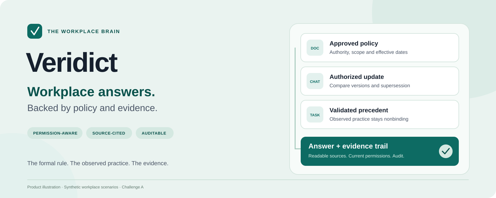
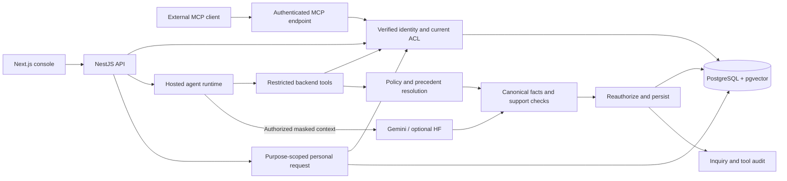

# Veridict: Evidence-Grounded Workplace Knowledge Assistant

**Workplace answers, backed by policy and evidence.**
Find the rule that applies, open its sources, and understand where policy and practice differ.

**[Try the interface](#try-the-interface)** · **[Architecture](#architecture)** · **[Results](#results)** · **[Challenge A requirements](#challenge-a-requirements-where-to-see-each)** · **[Documentation](docs/README.md)** · **[Run locally](#run-it-locally)**

*A hackathon prototype for Challenge A — The Workplace Brain, Tencent Cloud AI CAN DO IT Hackathon Indonesia 2026. Demo scenarios use synthetic workplace data. Organizer test results and production accuracy are not claimed.*

| Agent and grounding checks | Application and access checks |
| --- | --- |
| **57 / 57** offline agent tests passed | **83 / 83** API, contract and frontend transport tests passed |
| Policy facts rendered from validated backend records | Current permissions checked on retrieval and evidence access |

Recorded on **7 November 2026** at the connected AI-off checkpoint. These are regression-test counts, not answer-accuracy percentages. [Measurement scope and limitations](#results).

## A quick look

Workplace knowledge rarely lives in one place. A document describes a rule, a chat announces a change, and a task records what happened in practice. Veridict puts those records behind current access checks and returns an answer with an evidence trail.

| Question | What Veridict helps establish |
| --- | --- |
| **“Berapa tunjangan bensin yang berlaku?”** | Compare the old Rp500,000 SOP with the approved Rp750,000 HR update, its references and supersession |
| **“Can VP approve this SaaS renewal?”** | Keep the formal Director requirement separate from 23 VP approvals in a synthetic ledger of 26 comparable cases |
| **“What does this source actually say?”** | Open the normalized excerpt, source version, effective dates and integrity information |
| **“Who can help when evidence is insufficient?”** | Refer to an owner whose directory evidence is accessible and whose subject is unambiguous |
| **“Can I see this personal value?”** | Check explicit intent, source access, category and purpose before releasing one value |

These are reproducible [synthetic fixtures](docs/demo-fixtures.md), not claims that every live-model scenario has passed.

### Try the interface

Start the frontend using [the quick setup below](#frontend-only-demo), then open **[the local demo](http://localhost:3000/login?demo=1)** or select **Explore with demo data** on the sign-in page.

| What to explore | Local demo route | What to look for |
| --- | --- | --- |
| Employee home | [Console](http://localhost:3000/login?demo=1&next=/console) | Questions, history and answer states |
| Conflicting policy | [Fuel allowance](http://localhost:3000/login?demo=1&next=/console/inquiry/demo-fuel) | Current rule, outdated alternative and citations |
| Safe refusal | [Restricted topic](http://localhost:3000/login?demo=1&next=/console/inquiry/demo-kenari) | No protected excerpt or source-existence confirmation |
| Policy versus practice | [Approval reconciliation](http://localhost:3000/login?demo=1&next=/console/inquiry/demo-saas) | Official authority, nonbinding precedents and the gap |
| Missing knowledge | [Insufficient evidence](http://localhost:3000/login?demo=1&next=/console/inquiry/demo-missing) | An honest limit and an available next step |

These links point to **your local server**. The browser demo uses labeled synthetic answers and makes no model calls. Connected behavior and permissions require the backend. Sign out of an existing connected session before entering the demo.

## What it does

**The backend owns authorization and formal policy decisions.** The agent interprets the question, selects permitted tools and checks support. For curated policy evidence, backend rules determine applicability, authority, effective time and explicit supersession.

- **Three source types:** document text, chat exports and task records, ingested as normalized text/JSON with source and chunk identifiers.
- **Permission-aware retrieval:** organization, department and user grants filter sources before lexical or model-matched vector ranking.
- **Cited evidence:** readable excerpts, source type, version, dates, normalized-text spans and integrity hashes.
- **Official, operational and temporal truth:** distinguish the formal rule, validated historical practice and the selected validity window.
- **Deterministic policy gates:** observed policy domains must be resolved; missing or incorrectly typed context requests clarification, and unresolved conflicts have no declared winner.
- **Fresh answer checks:** policy snapshots are checked before persistence and on subsequent reads. Changed policy can require revalidation; revoked source access hides the related inquiry.
- **Owner handoff:** an insufficient answer can retain a uniquely verified owner backed by readable directory evidence.
- **Purpose-scoped personal data:** ordinary evidence stays masked. A dedicated request can release one authorized value without sending it to cloud inference.
- **Human-reviewed feedback:** feedback stays pending until an independent reviewer with the required domain and source permissions validates it.
- **Correlated audit:** inquiry, tool-call, source and outcome events can be traced under current access controls.
- **Employee and reviewer consoles:** history, evidence viewer, reconciliation, feedback and trace views, with explicit demo and connected modes.

The input pipeline accepts text and JSON exports. Direct PDF/DOCX parsing and live workplace-platform connectors are future work.

### Answer modes

| Mode | What happens | What it requires |
| --- | --- | --- |
| **Browser demo** | Displays labeled synthetic answers and interactions | Frontend only; no backend or model key |
| **Connected · AI off / Tanpa AI** | Returns keyword-matched, masked source excerpts with citations | Authenticated backend and PostgreSQL; no inference key |
| **Connected · AI on** | Uses the configured model and restricted backend tools, with policy gates and support checks | Authenticated backend, PostgreSQL and valid provider configuration/quota |

**AI off returns excerpts, not an interpreted policy decision.** It does not infer synonyms, select applicable rules or reconcile conflicts. The selected `processing_mode` belongs to the inquiry and cannot be changed through the run request. Existing inquiries default to AI on. [Answer-mode behavior and migration](docs/answer-modes.md).

Personal-data requests use their dedicated backend authorization path in either connected mode. Ordinary evidence remains masked even for a user who can request a particular value.

## Recent improvements

- **Policy facts cannot be replaced by a model draft.** Official statements, formal amounts/authority and exclusions come from backend resolution.
- **Conflicts stay visible.** Competing applicable approved claims are quoted with evidence, without choosing an unsupported winner.
- **Incomplete context stays incomplete.** Missing fields, incorrectly typed values and inconsistent scopes request clarification instead of a less specific fallback.
- **History checks current policy.** A change during verification blocks persistence; a later change can mark an answer `NEEDS_REVALIDATION`.
- **Owner handoff survives safe abstention.** Unavailable or ambiguous candidates are not automatically selected.
- **Personal requests are available from the evidence drawer.** Explicit intent, category, purpose and current grants determine release.
- **Questions are no longer cached in browser storage.** History uses server-redacted titles, and the legacy cache is cleared.
- **Processing errors say what happened.** Application limits, model quota/rate limits, service capacity, expired sessions and changed evidence have distinct messages.

[Policy flow and limits](docs/policy-orchestration.md) · [Personal-data flow](docs/privacy-flow.md)

## Architecture



The hosted agent uses a bounded backend-service dispatcher. External clients can use Streamable HTTP MCP at `/mcp` with an inquiry-bound delegated token. Model parameters cannot select a different actor or organization. Connected AI-off requests use lexical retrieval and source excerpts without the model path.

**Gemini** is the default provider. **Hugging Face** requires explicit selection; errors do not trigger automatic fallback. WorkBuddy connector instructions and configuration are included, while proof of an actual WorkBuddy invocation remains a separate acceptance item.

Retrieval is **lexical by default**. Vector retrieval needs real caller-supplied embeddings with matching model identifiers and dimensions; no embedding provider is configured automatically.

[Architecture and trust boundaries](docs/architecture.md) · [Runtime setup](docs/gemini.md) · [MCP instructions](integrations/workbuddy/agent-instructions.md)

## Results

**Recorded checkpoint: 7 November 2026, commit `75cf578`.** Offline validation used Node.js 24.21.0, PostgreSQL 17/pgvector, synthetic identities and data, and an isolated container without external inference.

| Check | Recorded result |
| --- | --- |
| Agent regression tests | **57 passed**, 0 failed, 0 skipped |
| API, contract and frontend transport tests | **83 passed**, 0 failed, 0 skipped |
| Contracts, agent and API TypeScript compilation | Passed |
| Frontend TypeScript check | Passed |
| Backend ESLint | Passed |
| Frontend Next/React/TypeScript lint rules | Passed with a portable Node import resolver |
| Live-model acceptance and official organizer suite | Pending |

Coverage includes pre-retrieval access checks, restricted/nonexistent responses, source and personal-grant revocation, policy supersession, exact time and numeric boundaries, partial context, unsupported citations, owner ambiguity, bounded calls, audit correlation and session cleanup. Policy replay cases cover Indonesian, English and mixed-language inputs despite an incorrect scripted model draft.

The sandbox applied committed migration SQL through `psql` and adapted test database lifecycle commands. This did not validate Prisma's migration CLI or regeneration. The original native frontend resolver on Windows, a production frontend bundle and interactive browser journeys were not rerun at this checkpoint. AI-off coverage includes mode persistence, zero provider initialization, masked excerpts and access revocation.

A prior live fuel scenario returned safe abstention instead of the expected amount; a later evaluation stopped on provider HTTP 429. The latest canonical policy gates passed offline and still require real-provider acceptance. No production speed, cost, accuracy, user-impact or organizer-score benchmark is claimed.

**Determinism has a defined scope:** the same authorized records, structured domain/context and business time produce the same policy decision. Natural-language intent, retrieval choices and general semantic relevance remain model-dependent. Uncurated text uses the general grounding path; legacy answers and manual external completions have the limits documented in the policy guide.

[Complete verification record](docs/verification.md) · [Actual runtime checkpoints](docs/person-1-checkpoints.md)

## Responsible AI and security

- **Authorization before retrieval:** identity, active status and source grants are checked in backend code. Administrators also need source access.
- **Current access on read:** evidence opens, inquiries, precedents, policy snapshots and trace references use current authorization.
- **Untrusted source content:** documents, chat and tasks cannot change identity, grants, tool schemas or policy publication authority.
- **Formal authority:** historical frequency describes comparable practice; it does not grant an exception or execute an approval.
- **Default masking:** disclosure needs an explicit request and a matching category/purpose grant. Contextual names, addresses, salary and health information require curator annotations; detection is not universal.
- **Human authority:** READ does not imply REVIEW. A model cannot publish policy or validate its own feedback.
- **Bounded runs:** at most six drafting calls, one support check and twelve tools, including automatic policy/owner lookups. Input limits, request throttling and concurrency limits remain enforced.
- **Safer audit:** query, answer and disclosed-value hashes support correlation; protected records hold content. Provider bodies and credentials are not returned as processing errors.
- **Explicit modes:** browser fixtures are not silently substituted for failed connected runs. AI-off excerpts are labeled separately from interpreted answers.
- **Knowledge assistance:** Veridict does not send workplace messages, approve transactions, move money or rewrite policy autonomously.

[Accountability](docs/accountability.md) · [Privacy controls](docs/privacy-flow.md) · [Backend limits](docs/backend.md)

## Challenge A requirements, where to see each

Offline implementation evidence is separate from live-model and organizer acceptance.

| Requirement | Implementation and evidence | Acceptance scope |
| --- | --- | --- |
| Indonesian, English or mixed answers with citations | [Hosted agent](packages/agent/src/grounded-agent.ts), [policy replay tests](packages/agent/test/policy-orchestration.test.cjs), [evidence metadata](apps/api/src/knowledge/content.ts) | Scripted multilingual policy cases pass; general live-language evaluation pending |
| Authorization before retrieval and changed access | [Authorized retrieval](apps/api/src/knowledge/knowledge.service.ts), [security scopes](apps/api/src/auth/security.service.ts), [integration tests](apps/api/test/backend.test.cjs) | Offline API/MCP revocation regressions pass |
| Restricted refusal without revealing existence | [Grounding tests](packages/agent/test/grounded-agent.test.cjs), [synthetic fixtures](apps/api/fixtures/demo.json) | Restricted/nonexistent fixture checks pass; real-model acceptance pending |
| Conflicts, source selection and authority | [Policy resolver](apps/api/src/policy/policy.service.ts), [canonical output](packages/agent/src/policy-guard.ts), [policy flow](docs/policy-orchestration.md) | Curated supersession and unresolved-conflict tests pass |
| Abstention and authorized owner referral | [Domain-owner service](apps/api/src/escalations/escalations.service.ts), [owner tests](packages/agent/test/policy-orchestration.test.cjs) | Safe abstention and verified/ambiguous/unavailable owner cases pass offline |
| Query, source and response audit | [Audit implementation](apps/api/src/audit), [inquiry traces](apps/api/src/inquiries/inquiries.service.ts), [verification](docs/verification.md) | Correlation and organization-scoped access checks pass offline |
| Bonus: freshness after ingestion | [Ingestion and versions](apps/api/src/knowledge/knowledge.service.ts), [snapshot checks](docs/policy-orchestration.md) | Known policy/source changes covered; full live evaluation pending |
| Bonus: source prompt-injection resistance | [Restricted dispatcher](packages/agent/src/grounded-agent.ts), [injection fixtures](packages/agent/test/grounded-agent.test.cjs) | Structural defenses tested; comprehensive real-model resistance unverified |
| Bonus: personal-data masking | [Disclosure service](apps/api/src/personal-data/personal-data.service.ts), [privacy flow](docs/privacy-flow.md) | Intent, category/purpose grants, ambiguity and revocation tested |
| Bonus: chat + document + task synthesis | [Three-source scenario](docs/demo-fixtures.md), [ingestion and retrieval](apps/api/src/knowledge/knowledge.service.ts) | Source handling available; general live synthesis acceptance pending |

## Documentation

[Documentation index](docs/README.md) — architecture, privacy, accountability, runtime setup, fixtures, API contracts and evaluation evidence.

| Start here | What it explains |
| --- | --- |
| [Product specification](Veridict_PRD_v1_Track_A.md) | Scope, acceptance cases and runtime decisions |
| [Policy orchestration](docs/policy-orchestration.md) | Canonical facts, snapshots, context, owner routing and determinism limits |
| [Answer modes](docs/answer-modes.md) | AI on/off, excerpts, demo distinction and migration |
| [Backend integration](docs/backend.md) | Authentication, endpoints, ingestion, grants and MCP |
| [Demo fixtures](docs/demo-fixtures.md) | Actors, scenarios and seeding |
| [Verification](docs/verification.md) | Dated checks, live failures and remaining validation |

## Run it locally

<details>
<summary>Prerequisites, demo, connected setup, checks and MCP</summary>

### Prerequisites

- **Node.js 22.12 or newer** and npm.
- **PowerShell 7** for these commands; adapt environment-variable syntax for other shells.
- **Docker Desktop** for the connected database and integration tests.
- Git.

Default ports: frontend **3000**, API **3001**, PostgreSQL **5432**.

### Frontend-only demo

From the repository root:

```powershell
npm ci
npm run build -w @veridict/contracts
npm run dev:web
```

Open [http://localhost:3000/login?demo=1](http://localhost:3000/login?demo=1). No database, account or inference key is needed.

If port 3000 is occupied, leave its process running and use another port:

```powershell
npm exec -- next dev apps/web --port 3002 --hostname 127.0.0.1
```

Open [http://127.0.0.1:3002/login?demo=1](http://127.0.0.1:3002/login?demo=1). For connected mode, set the backend's `WEB_ORIGIN` to the exact frontend origin, such as `http://127.0.0.1:3002`, and restart the API.

### Connected backend and frontend

For a fresh checkout:

```powershell
Copy-Item .env.example .env
Copy-Item apps/api/.env.example apps/api/.env
Copy-Item apps/web/.env.example apps/web/.env.local
npm run db:up
npm run db:deploy
npm run build
```

Keep existing environment files when updating an installed workspace. If root database credentials or the port change, update `DATABASE_URL` in `apps/api/.env` too. An existing PostgreSQL instance can replace Compose if the `vector` extension and committed migrations are available. Example credentials are for local development.

Seed a **new synthetic organization**:

```powershell
$env:ALLOW_DEMO_SEED = 'true'
$env:DEMO_ORG_SLUG = 'veridict-demo'
$env:DEMO_PASSWORD = Read-Host 'Choose a demo password (12+ characters)' -MaskInput
npm run demo:seed
Remove-Item Env:DEMO_PASSWORD
Remove-Item Env:ALLOW_DEMO_SEED
npm run dev
```

Open [http://localhost:3000/login](http://localhost:3000/login). Use organization **`veridict-demo`**, **`employee@example.test`** or **`reviewer@example.test`**, and your chosen password. Accounts exist only after seeding. Existing organization slugs are rejected; the seed does not reset or delete data.

Alternatively, create your own organization and administrator after building:

```powershell
$env:BOOTSTRAP_ORG_SLUG = 'veridict'
$env:BOOTSTRAP_EMAIL = 'admin@example.test'
$env:BOOTSTRAP_PASSWORD = Read-Host 'Choose an administrator password (12+ characters)' -MaskInput
npm run admin:bootstrap
Remove-Item Env:BOOTSTRAP_PASSWORD
```

Use the organization and email you supplied on the login form. An existing organization slug is rejected; there are no default accounts or public registration. See [authentication](docs/backend.md#authentication) for API login examples.

API: [http://localhost:3001](http://localhost:3001). `GET /health` is public; business endpoints require authentication.

### Model configuration

Connected **AI off** needs the backend and database but no inference key. For **AI on**, configure only the ignored `apps/api/.env`:

```dotenv
AI_PROVIDER=gemini
GEMINI_API_KEY=<your backend-only key>
GEMINI_MODEL=gemini-3.5-flash
```

Restart the API after changing configuration. Provider credentials must not go in `NEXT_PUBLIC_*` variables. Connected AI-on questions can consume inference quota; check model access and quota for the account being used. Hugging Face is an [explicit alternative](docs/huggingface.md), never an automatic fallback.

### Checks and evaluation

```powershell
npm run typecheck
npm run lint
npm run test:agent
npm run test:api
```

Ordinary tests use local fixtures and do not call a live LLM. API integration tests create and remove an isolated PostgreSQL container on an automatically assigned port, without using the development database. Docker must be running with `pgvector/pgvector:pg17` available.

Live evaluation is a separate opt-in operation that calls the configured provider:

```powershell
$env:AI_LIVE_TEST = '1'
npm run test:ai:live
Remove-Item Env:AI_LIVE_TEST
```

Review one synthetic result before the full-suite option in [the runtime guide](docs/gemini.md). Demo output and scripted tests do not substitute for live acceptance.

### MCP integration

Streamable HTTP MCP is available at **`http://localhost:3001/mcp`** after the API starts. A verified user issues an inquiry-bound delegated token through `POST /v1/auth/tool-token`; the client uses that bearer token. Agent sessions cannot create users, issue more tokens or perform human-review operations.

[Connector template](integrations/workbuddy/mcp.example.json) · [Agent instructions](integrations/workbuddy/agent-instructions.md) · [API and MCP examples](docs/backend.md)

The hosted runtime uses backend services directly. A real WorkBuddy invocation needs its own evidence; a local MCP smoke test does not establish that connection.

### Repository layout

```text
apps/web/                    Next.js employee/reviewer console and browser demo
apps/api/                    NestJS services, fixtures and tests
apps/api/prisma/             Data schema and committed migrations
packages/agent/              Grounding runtime, provider adapters and MCP smoke client
packages/contracts/          Shared TypeScript types and Zod schemas
integrations/workbuddy/      External-agent instructions and connector template
docs/                        Architecture, privacy, setup and verification
infra/postgres/              pgvector initialization
compose.yaml                 Local PostgreSQL service
```

</details>

## What's next

- **Live acceptance:** rerun conflict, multilingual, refusal, owner-handoff and injection scenarios with the configured provider; review every answer and citation.
- **Official fixtures and evidence:** execute the organizer corpus when available and capture genuine screenshots, traces and the submission video.
- **WorkBuddy contribution:** verify an actual invocation and document its real role.
- **Connected browser journeys:** exercise login, evidence reopening, grants, disclosure, feedback and failure recovery against the merged backend.
- **Retrieval evaluation:** measure matched embeddings, ranking quality, timing behavior and load on a representative permission-scoped corpus.
- **Broader ingestion:** add document parsing and workplace connectors with provenance, versioning and access synchronization.

## Built with

**Next.js App Router · React · TypeScript · Tailwind CSS · NestJS · Prisma 7 · PostgreSQL 17 · pgvector · Zod · Streamable HTTP MCP**

Gemini is the default model provider; Hugging Face is explicitly selectable. WorkBuddy integration templates are provided. OpenAI Codex assisted with implementation, regression checks, UI integration and documentation. Tool-use and model-evaluation claims remain tied to the evidence above.

### How we built it

We established authorization boundaries before joining retrieval to the agent. Source IDs, human-validated metadata and effective dates became the basis of formal policy decisions. Failures became regression cases: revoked access, superseded rules, unsupported citations, missing context and unavailable owners.

The practical lessons: define tool contracts first, keep formal policy decisions in backend code, test time boundaries without sleeping, label synthetic demonstrations, and record limitations alongside results.
