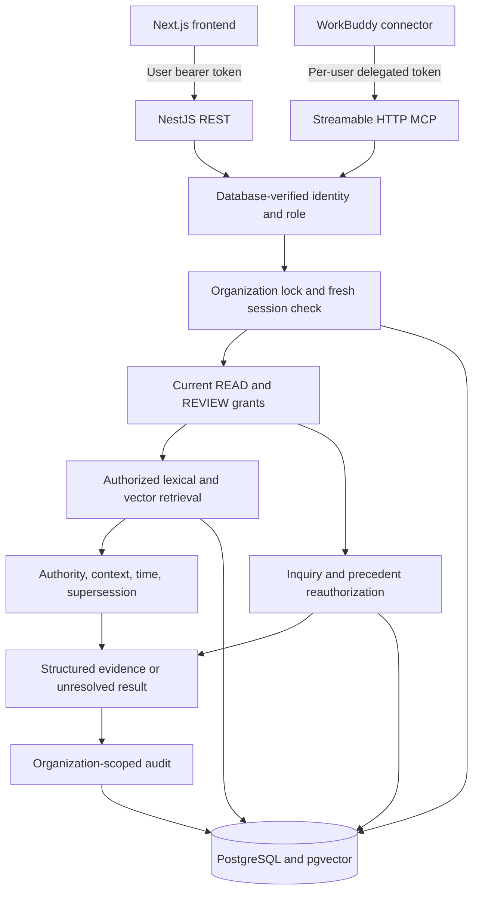

# Backend architecture and trust boundaries

The backend owns identity, current authorization, persisted evidence, deterministic policy checks, and audit. Person 1 owns WorkBuddy orchestration and semantic answer validation; Person 3 owns employee/reviewer interfaces.

Retrieved documents, chats, and tasks are untrusted data. They cannot change the actor, ACL, tool schema, or policy publication authority. The final agent must not treat embedded source instructions as tool commands.

Access is denied without an explicit matching grant. Administrators manage ACLs but need grants for retrieval. REVIEW is separate and requires human domain authority. A case remains visible only while all evidence is readable. A stored inquiry is hidden when any cited source loses access, including evidence in structured statements and trail nodes.

Prisma manages relational models/migrations; parameterized SQL handles full-text and pgvector retrieval. Exact filtered scans prioritize correctness for the hackathon corpus. Scaling and approximate indexes need separate measurement.

The backend makes no external LLM or WorkBuddy call. Inquiries wait for the connector to complete them. This boundary allows all three team members to work in parallel while the actual WorkBuddy connection is validated.
Domain-owner handoff is backed by readable directory evidence. Personal-data disclosure additionally requires a category/purpose grant and an immutable user-created inquiry request. Known sensitive values stay redacted on ordinary evidence, policy, precedent, review, and answer views. Contextual fields require curator annotations; the system is not a general PII discovery model.

Inquiry-bound agent sessions propagate server-generated tool-call IDs into audit. Owner-visible traces reauthorize their resource references; administrator audit remains organization-scoped. Shared synthetic fixtures are described in [the demo guide](demo-fixtures.md).
