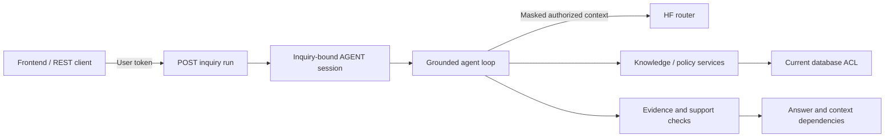

# Optional Hugging Face runtime

Gemini is now the primary provider: see [current setup](gemini.md). Set `AI_PROVIDER=huggingface` explicitly to use this adapter. There is no automatic provider fallback. The decision and 402 result below describe the earlier HF checkpoint.

Keputusan implementasi 6 November 2026: aplikasi memakai orkestrasi agen di NestJS dengan model melalui Hugging Face Inference Providers. WorkBuddy menjadi konektor eksternal opsional; aplikasi tidak perlu menunggu WorkBuddy untuk memproses inquiry. Ini perubahan rancangan tim, bukan pernyataan tentang kewajiban teknologi lomba.

## Konfigurasi lokal

Simpan konfigurasi di `apps/api/.env` yang diabaikan Git:

```dotenv
HF_TOKEN=<token HF milikmu>
HF_MODEL=meta-llama/Llama-3.1-8B-Instruct
HF_BILL_TO=
```

Token memerlukan izin Inference Providers. Model/provider harus tersedia untuk akun tersebut. Contoh mengikuti pilihan pengguna; tidak semua repository model menyediakan hosting atau tool calling. `HF_MODEL` menerima suffix seperti `namespace/model:provider` jika tersedia; tidak ada fallback model otomatis.

Endpoint adapter adalah `https://router.huggingface.co/v1/chat/completions`, bukan `https://huggingface.co`. Adapter memakai `fetch` server-side; tidak memerlukan OpenAI API key atau SDK. Jangan menaruh token pada frontend, variabel `NEXT_PUBLIC_*`, chat, atau file Git.

`HF_BILL_TO` opsional mengirim `X-HF-Bill-To` untuk organisasi/resource group yang secara eksplisit dipilih dan diizinkan. Jika kosong, billing mengikuti akun token.

Referensi resmi, diperiksa 6 November 2026: [chat completion](https://huggingface.co/docs/inference-providers/tasks/chat-completion), [function calling](https://huggingface.co/docs/inference-providers/guides/function-calling), dan [pricing/billing](https://huggingface.co/docs/inference-providers/pricing). Saat diperiksa, akun Free tidak mendapat kredit inference bulanan. Model yang bisa diunduh gratis tidak otomatis gratis di hosting API.

## Alur aplikasi



1. Login pengguna seperti [panduan backend](backend.md).
2. `POST /v1/inquiries` dengan `{ "question": "..." }` membuat inquiry `PENDING`.
3. Pemilik memanggil `POST /v1/inquiries/:id/run` dengan `{}` dan token pengguna yang sama. Body tidak dapat memilih model, token, identitas, atau inquiry lain.
4. Backend membuat sesi `AGENT` sementara terikat inquiry. Runtime memilih read tools, mengumpulkan bukti, memeriksa dukungan jawaban, dan menyimpan hasil melalui service inquiry.
5. Ambil hasil melalui `GET /v1/inquiries/:id`; trace tersedia di `GET /v1/inquiries/:id/trace`.
6. Sesi sementara dibersihkan setelah sukses/gagal. Token delegasi eksternal yang diterbitkan pengguna merupakan sesi terpisah.

Frontend Person 3 dapat memanggil `/run` setelah membuat inquiry. Endpoint sinkron; tidak ada queue atau streaming. Jika koneksi timeout, periksa status inquiry sebelum mengulang agar tidak menggandakan pemrosesan/kredit.

Contoh setelah login dengan `$headers` berisi bearer token pengguna:

```powershell
$api = 'http://localhost:3001'
$inquiry = Invoke-RestMethod -Method Post -Uri "$api/v1/inquiries" -Headers $headers -ContentType 'application/json' -Body (@{
  question = 'Berapa tunjangan bensin bulanan yang berlaku?'
} | ConvertTo-Json)
Invoke-RestMethod -Method Post -Uri "$api/v1/inquiries/$($inquiry.inquiry_id)/run" -Headers $headers -ContentType 'application/json' -Body '{}'
Invoke-RestMethod -Uri "$api/v1/inquiries/$($inquiry.inquiry_id)" -Headers $headers
```

## Pemeriksaan dan batas runtime

- Model mendapat tool search, policy resolution, precedent search, reconciliation, evidence read, domain-owner lookup, dan pengajuan jawaban untuk inquiry yang sudah terikat. Tidak ada tool admin, shell, publication, atau disclosure personal-data mentah.
- Input tool memakai schema contracts strict. Kutipan harus berasal dari bukti yang benar-benar dibaca; model tidak dapat memilih pengguna/inquiry lain.
- Sesi, READ, source/chunk, dan hasil masking diperiksa ulang sebelum permintaan model berikutnya dan penyimpanan. Seluruh chunk konteks menjadi dependency history, termasuk yang tidak dikutip draft. Pencabutan akses ke salah satunya menyembunyikan jawaban terkait.
- `ANSWERED` memerlukan bukti. Panggilan model terpisah tanpa tool memeriksa dukungan draft; hasil negatif/tidak valid menghasilkan abstention. Ini pemeriksaan berbasis model yang sama, bukan bukti entailment atau pertahanan injection sempurna. Unknown tool dan identity override ditolak deterministik.
- Maksimal enam putaran agen ditambah satu pemeriksaan dukungan, dua belas tool calls, empat tool calls per respons, dan seratus chunk. Output dibatasi 2.048 token/panggilan dengan timeout 30 detik. Tidak ada retry inference/fallback otomatis. Batas ini membatasi panggilan, bukan menjamin biaya nominal.
- Endpoint dibatasi sepuluh permintaan/menit per IP dan empat run aktif per proses, satu run per inquiry per proses. Untuk beberapa instance, koordinasi job/budget perlu penyimpanan terdistribusi; penyimpanan jawaban tetap memeriksa status dalam transaksi.
- Disclosure personal-data berizin tetap melalui endpoint yang sudah ada. Runtime HF hanya memakai bukti dimasking, termasuk untuk inquiry permintaan personal data.
- Pencarian tetap lexical tanpa embedding nyata. Adapter embedding dan evaluasi ranking multilingual adalah pekerjaan terpisah; tidak ada vektor palsu.

## Error yang dapat ditindaklanjuti

| Error                                          | Tindakan                                                            |
| ---------------------------------------------- | ------------------------------------------------------------------- |
| `AI_NOT_CONFIGURED`                            | Isi `HF_TOKEN` dan ID model valid, lalu restart API                 |
| `AI_AUTH_FAILED` / `AI_ACCESS_DENIED`          | Periksa token, izin inference, dan akses model                      |
| `AI_QUOTA_EXHAUSTED`                           | HF mengembalikan 402; periksa billing akun/organisasi yang dipilih  |
| `AI_RATE_LIMITED`                              | Tunggu kuota pulih; hindari loop retry                              |
| `AI_MODEL_UNAVAILABLE`                         | Periksa ketersediaan model/provider pada router                     |
| `AI_INVALID_RESPONSE` / `AI_INVALID_TOOL_CALL` | Periksa dukungan kontrak/tool calling model                         |
| `AI_UNSEEN_EVIDENCE`                           | Draft mengutip bukti belum dibaca atau eskalasi belum terverifikasi |
| `AI_BUDGET_EXCEEDED`                           | Persepit pertanyaan/konteks                                         |

Kegagalan sebelum penyimpanan mempertahankan status inquiry sebelumnya. Error tidak memuat body mentah HF atau token. Audit mencatat identitas, tool, status, dan hash hasil; tidak mencatat prompt/source atau kredensial.

## Pengujian dan evaluasi nyata

`npm run test:agent` menggunakan fixture lokal. `npm run test:api` menggunakan PostgreSQL sementara dan model scripted. Keduanya tidak memakai kredit HF. [Corpus sintetis bersama](demo-fixtures.md) menyiapkan konflik bensin, proyek terbatas, Director/VP, dan multi-source.

Tes nyata berikut memakai token lokal dan kredit akun. Container/database sementara dibersihkan; laporan aman disimpan di `docs/evaluation/`:

```powershell
$env:HF_LIVE_TEST = '1'
npm run test:hf:live
# Setelah satu skenario berhasil, perluas ke lima skenario:
npm run test:hf:live -- --all
Remove-Item Env:HF_LIVE_TEST
```

Runner berhenti ketika provider gagal. Pemeriksaan otomatis laporan menguji struktur, evidence, dan ekspektasi terbatas; makna jawaban, bahasa, klaim, dan non-disclosure tetap perlu review manusia.

Uji nyata pertama 6 November 2026 mencapai HF tetapi mendapat HTTP 402. Hasil 0/1 skenario selesai, inquiry tetap `PENDING`; lihat [laporan kegagalan aktual](evaluation/hf-live-2026-11-06T11-30-48-588Z.json). Kode terintegrasi dan tes lokal tidak berarti jawaban model nyata sudah tervalidasi.
